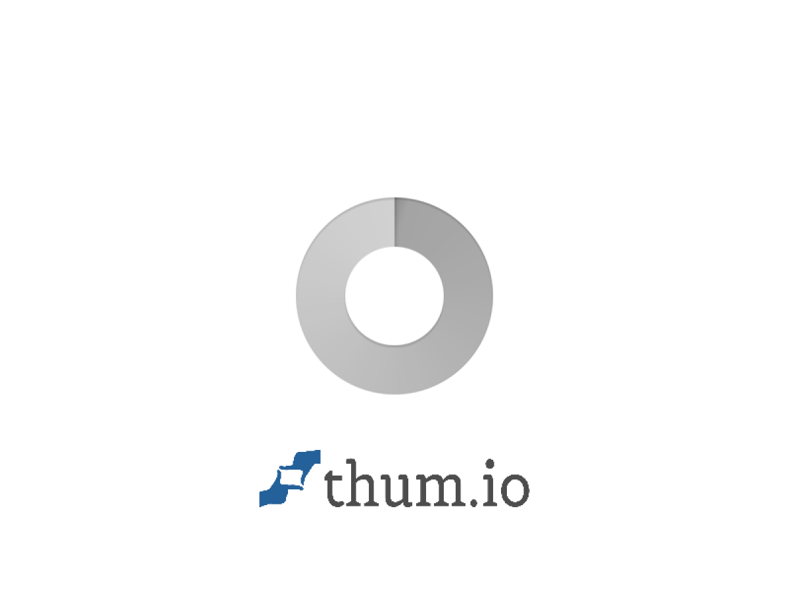

# Kiwi · English Training Tool


一个面向中文初学者的英语训练工具作品集。它把英语学习拆成可练习、可复习、可持续迭代的内容模块：发音、单词、口语、句子、阅读任务和专项英语。

> Kiwi 是这个项目的学习伙伴形象：轻量、友好、持续成长。每一次版本更新，Kiwi 都会带来一组新的学习内容或交互体验。

## 作品集预览

在线体验：<https://english-training-tool.vercel.app/>

第一次使用说明：<https://english-training-tool.vercel.app/guide.html>

- **训练中心**：按学习等级组织发音、单词、口语、语法和句子训练。
- **口语卡片**：美式音标、慢速/常速朗读、句子意群、重点词和个性化回复。
- **专项英语**：计算机科学与心理学概念的中英双语学习卡片。
- **任务中心**：以真实生活文本为素材的阅读理解任务。
- **全局查词**：网页端双击查词，支持本地课程词典与线上词典兜底。
- **多语言入口**：英语与法语模块共用一致的学习界面。

## 给第一次访问者

如果你只是想了解这个项目，可以先打开[用户指南](https://english-training-tool.vercel.app/guide.html)；如果你想直接体验产品，可以从[首页](https://english-training-tool.vercel.app/)查看公开介绍与课程入口。

项目截图和演示图应放在 `assets/screenshots/`，每张图配一条简短说明，优先展示真实学习场景：训练中心、口语卡片、双击查词、专项英语和用户指南。

## 视觉预览



*用户指南：让第一次访问的学习者知道从哪里开始。*


*首页：展示产品定位、价格和训练模块入口。*


*训练中心：按学习等级组织发音、单词、口语和其他训练模块。*


*专项英语：用双语概念卡片学习 Python 和心理学相关英语。*

## Kiwi 的版本方式

内容和页面逻辑分开维护。新增内容时优先更新对应模块的数据文件；删除内容时通过内容清单移除，不破坏学习页面的通用交互。每次公开更新都通过版本号和 `CHANGELOG.md` 留下记录。

```text
content/       可持续扩展的课程内容说明与示例
assets/        公开展示所需的品牌资源
docs/          公开仓库与发布规范
*.html         页面结构
*.js           页面交互与课程逻辑
*.css          视觉系统与响应式排版
```

## 本地运行

这是一个无构建依赖的静态网站。可以直接使用任意静态服务器打开项目目录，例如：

```bash
python3 -m http.server 8080
```

然后访问 `http://localhost:8080`。

## 公开仓库边界

这个仓库只展示产品结构、交互设计和公开示例内容。私人兑换码、个人联系方式、个人头像、本地文件路径、私有配置和游戏原声不进入公开仓库；魔兽争霸模块仅保留本地导入机制和教学界面示例。

详见 [`docs/public-release.md`](docs/public-release.md)。

## 技术关键词

`HTML` · `CSS` · `Vanilla JavaScript` · `Web Speech API` · `localStorage` · `Responsive UI` · `Vercel`

## 版本记录

请查看 [`CHANGELOG.md`](CHANGELOG.md)。
